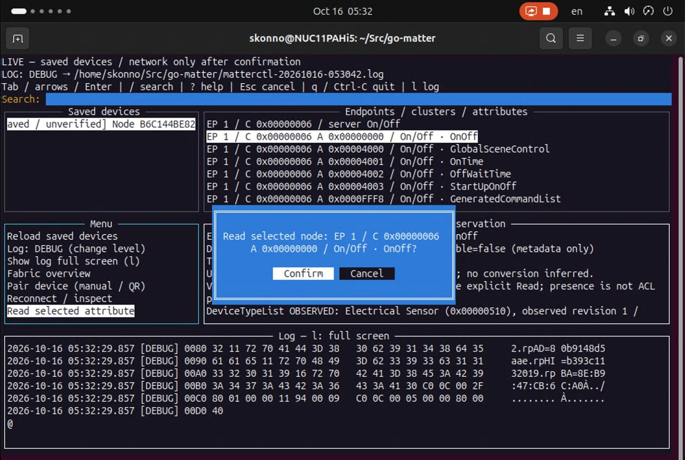

[](https://github.com/cybergarage/go-matter/actions/workflows/make.yml)
[](https://pkg.go.dev/github.com/cybergarage/go-matter)
 [](https://goreportcard.com/report/github.com/cybergarage/go-matter) 
 [](https://codecov.io/gh/cybergarage/go-matter)

# go-matter

Matter is an open-source connectivity standard for smart home and IoT (Internet of Things) devices.
`go-matter` is a Go library for building a Matter controller, and `matterctl` is the command which drives it.

go-matter v1.0 completes the commissioner, with a stable API. Running as a Matter device is in development, for v1.1.

## Features

- Commissioning over **BLE** (BTP) and **IP**: discovery from a QR code or manual pairing code, PASE, the fail-safe, CSR and NOC issuance, Wi-Fi network credentials, and CASE
- **Device attestation**: the DAC → PAI → PAA chain and the Certification Declaration, against a bundled snapshot of the DCL
- A persistent **store** of the fabric and its nodes, and a **key store** for the fabric's keys (encrypted files, or any `crypto.Signer`)
- **Reconnection** with CASE session resumption
- The **Interaction Model**: read, write, invoke, subscriptions to attributes and events, event reads
- **Multi-admin**: opening a commissioning window to share a node with another ecosystem, verified with Google Home
- Cluster clients, and a data model catalog to build command fields by name
- **`matterctl`**, a CLI and a full-screen terminal controller

Not supported yet: Thread commissioning, revocation checking, devices which support only non-concurrent connection, groups, scenes and OTA. Running as a Matter **device** is in development, for v1.1.0. See [what go-matter supports](doc/features.md) for the details.

## Install

```
go get -u github.com/cybergarage/go-matter
```

The `matterctl` command is installed with:

```
go install github.com/cybergarage/go-matter/cmd/matterctl@latest
```

## Quick start

A commissioner is started once, and then commissions devices and reaches the nodes of its fabric.

```go
commissioner := matter.NewCommissioner()
if err := commissioner.Start(); err != nil {
	return err
}
defer commissioner.Stop()

// The manual pairing code, or the QR code payload (MT:...), of the device.
payload, err := encoding.NewPairingCodeFromString(code)
if err != nil {
	return err
}

// A device found over BLE also needs the Wi-Fi network it is to join.
wifi := config.NewWiFiNetworkConfig(config.WithSSID(ssid), config.WithCredentials(password))
commissionee, err := commissioner.Commission(ctx, payload, matter.WithCommissionWiFiNetwork(wifi))
if err != nil {
	return err
}
nodeID, _ := commissionee.NodeID()

// Later, or after a restart: the node is reached again through the store.
node, err := commissioner.Connect(ctx, nodeID)
if err != nil {
	return err
}
defer node.Close()
res, err := node.ReadAttribute(ctx, endpointID, clusterID, attributeID)
```

The [commissioner guide](doc/commissioner.md) covers commissioning options and progress, device attestation, subscriptions and events, reconnection, the key store and sharing a node with another ecosystem.

## matterctl

`matterctl` commissions and operates a device from a terminal.

```
$ matterctl scan
$ matterctl pairing code 1 MT:-24J0AFN00KA0648G00
$ matterctl pairing code-wifi 1 MT:-24J0AFN00KA0648G00 <ssid> <password>
$ matterctl onoff on 1 1
$ matterctl any subscribe 0x0006 '*' 1 1
```

`matterctl tui` is a full-screen controller (`make tui`): saved devices, their endpoints, clusters and attributes, reads and commands after a confirmation, and the log.



See the [command reference](doc/matterctl.md) and the [full-screen controller](doc/matterctl-tui.md).

## API stability

From v1.0.0, the commissioner's API follows [semantic versioning](https://semver.org/spec/v2.0.0.html): the `matter` package, configurations and identifiers, onboarding codes, stores, credentials, cluster clients, the data model and the client side of the Interaction Model change incompatibly only in a new major version. The protocol internals may change in a minor version, and the device role is experimental until v1.1.0. See [packages](doc/packages.md) for the list.

## Documentation

| Guide | |
| --- | --- |
| [Commissioner guide](doc/commissioner.md) | Commissioning, attestation, subscriptions and events, reconnection, the key store, multi-admin |
| [What go-matter supports](doc/features.md) | Roles, supported features and what is not supported yet |
| [Packages](doc/packages.md) | Every package, and which follow semantic versioning |
| [matterctl](doc/matterctl.md), [full-screen controller](doc/matterctl-tui.md) | The command |
| [Commissioner persistent store](doc/commissioner-store.md) | The store of the fabric and its nodes, and the key store |
| [Data model catalog](doc/matter-definition-db.md) | The version-pinned device and cluster metadata |
| [Device (in development)](doc/device.md), [device persistent store](doc/device-store.md) | The device role |
| [CHANGELOG](CHANGELOG.md) | The changes of each release |
| [Go reference](https://pkg.go.dev/github.com/cybergarage/go-matter) | The API |

The implementation follows the Matter 1.5 specifications ([Core, Application Cluster, Device Library and Standard Namespace](https://csa-iot.org/developer-resource/specifications-download-request/)) and the reference implementation, [project-chip/connectedhomeip](https://github.com/project-chip/connectedhomeip).

## Related projects

| Project | Status | Description |
|---------|--------|-------------|
| [go-ble](https://github.com/cybergarage/go-ble) | v0.9.3 (central only) | Go package for Bluetooth Low Energy (BLE) communication |
| [go-mdns](https://github.com/cybergarage/go-mdns) | v1.0.1 | Go package for mDNS (Multicast DNS) and DNS-SD: service discovery and publication |

## Licenses and third-party files

go-matter is licensed under the [Apache License 2.0](LICENSE).

**Test credentials.** `matter/credentials/testcreds` contains the public test attestation credentials of the Matter SDK, [project-chip/connectedhomeip](https://github.com/project-chip/connectedhomeip) (Apache License 2.0): the development DAC and PAI for vendor ID 0xFFF1 and product ID 0x8000, the test PAA, and the example Certification Declaration. They are copied unmodified from commit `d305b0761957c960c26c0841e1b50add2365871d`, with the SDK's `LICENSE` and `NOTICE`. See [matter/credentials/testcreds/certs/README.md](matter/credentials/testcreds/certs/README.md) for the source of each file. They are for development and testing only: their private key is public, and commissioners accept them only in development mode.

The data model catalog carries metadata of the Matter SDK; see [its source licensing](doc/matter-definition-db.md). The full-screen controller's third-party notices are in [doc/tui-third-party-notices.md](doc/tui-third-party-notices.md).
